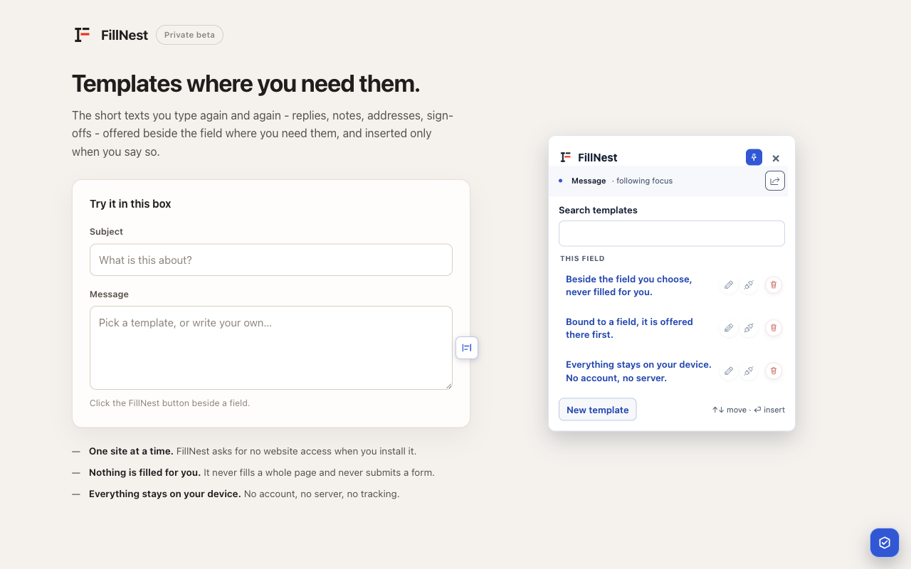
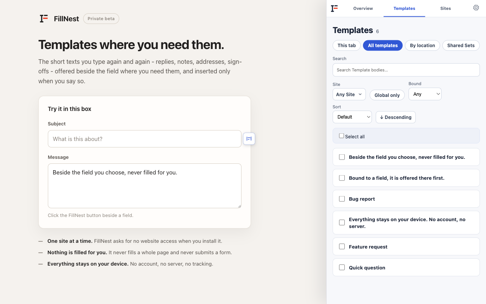

# FillNest

**Your templates, right where you type.** A Chrome extension that offers your saved texts beside the web field you are typing in, and inserts one only when you choose it.

**[Install from the Chrome Web Store](https://chromewebstore.google.com/detail/fillnest/aefjighkledcgodcmepkbfgaollgpolp)**

## At a glance

- **Problem:** people retype the same replies, notes and details into web forms every day. Tools that guess and fill whole pages can put the wrong text in the wrong place.
- **Approach:** FillNest is deliberately conservative. It never fills a page or submits a form. It only recognises a field when the evidence is strong, and treats anything uncertain as new ("identity over similarity", fail closed).
- **Privacy:** local-first. No account, no server, no tracking. It asks for website access one site at a time.
- **Status:** version 0.2.0 beta, [published on the Chrome Web Store](https://chromewebstore.google.com/detail/fillnest/aefjighkledcgodcmepkbfgaollgpolp). English and Simplified Chinese. Privacy policy: [PRIVACY.md](PRIVACY.md).
- **Stack:** Manifest V3, TypeScript, Preact, Vite; Vitest and Playwright: 1,110 unit tests plus about 50 end-to-end test files.

## How it was built

I designed the product, wrote the requirements and acceptance criteria, and reviewed and tested the results. Most of the code was written by AI coding agents (Codex and Claude) working under a written process: each meaningful change has a task contract with scope, risks and acceptance criteria, is built in small verified steps, and is reviewed before it is accepted.

- `tasks/` holds more than 40 task contracts and reviews; `docs/adr/` holds architecture decisions.
- `PROJECT.md`, `CONTEXT.md` and `AGENTS.md` are the product foundation, domain language and rules the agents follow.
- The process itself is published separately as [Agentic Engineering Starter Kit](https://github.com/AndrewWang003/agentic-engineering-starter-kit).

This public repository is a clean copy of a private working repository, so the commit history starts here.

## Product details

FillNest is a local-first Chrome Extension for field-aware plain-text templates.

FillNest places a quiet template picker next to supported web fields. Users create, search, bind, and insert reusable text while retaining control over every website permission, insertion, binding, and destructive action.

## V1 Direction

V1 is a usable validation MVP focused on a conservative local workflow:

- Explicit activation for the current Permission Origin through its Permission Host Pattern.
- Separate Global Active or Pause, per-origin Active or Pause, and Chrome Website Access controls.
- A compact Extension Popup, an authorized-page status control, and a Chrome Side Panel for management.
- Static, conditional, and SPA-created field detection.
- Focus reveals a FillNest control; activating that control opens the Inline Picker.
- Plain-text Template creation, editing, deletion, search, binding, and insertion.
- Cursor insertion or selected-text replacement without whole-field replacement.
- A global local Template Library organized by location, Global status, body Search, and soft Site Affinity filtering.
- Strict two-state field recognition: reliably recognized or treated as new.
- Same-site Page Profile and Field Profile matching.
- Search-only, evidence-backed cross-site relevance for limited contact-like single values.
- Local Backup Archive export and restore.

## Since V1

Version `0.2.0` is the Chrome Web Store beta. Beyond V1's scope
above, it adds:

- **Rich text fields** - chat composers and other `contenteditable` editors,
  with insertion at the caret and a copy-to-clipboard fallback when an editor
  refuses the text.
- **Logical Page Identity** - a user-confirmed rule that lets one saved Field
  be recognized across repeated record pages on the same site.
- **Shared Template Sets** - an explicit, site-local (and, with confirmation,
  cross-site) way to give several Fields the same Templates, with per-Field
  overrides, exclusions and Templates private to one Field, managed from the
  Templates page's `Shared Sets` tab.
- **Compatibility candidate suggestions** - a Field Finder that offers Fields
  the current one could share with, driven by Search rather than by guessing.
- **Simplified Chinese** alongside English, chosen in Settings or following
  the browser.
- **Appearance** - six themes in light and dark, plus a System mode, applied
  across the Popup, the Side Panel and the Inline Picker.
- **A movable page status control**, and store packaging (`npm run package`).

`CHANGELOG.md` lists every change by version.

## User Control

- Selecting a Template inserts text; selecting Bind creates only a Binding.
- Recognized fields initially show only their bound Templates.
- Global Templates appear only after the user enters Search or chooses `Search all templates`.
- FillNest never fills a whole page, replaces an entire field automatically, or submits a form.
- Existing field content is read only after the user explicitly chooses `Use current field content`, or opens the Picker over a selection (shown, never stored); `docs/privacy-policy.md` names the one other read, after a rich text insertion.
- Password, payment, one-time-code, and other excluded sensitive fields are not supported.

## Technical Baseline

- Manifest V3 and TypeScript.
- npm, Vite, and Preact.
- Offline ICANN Public Suffix List parsing for Site identity.
- `chrome.storage.local` behind a versioned Repository.
- A service worker for Permissions and business-data operations.
- Vitest and Playwright for fast and built-extension validation.

## V1 Exclusions

- Backend services, network-dependent features, and remote code.
- AI, model APIs, embeddings, semantic search, or vector databases.
- Accounts, sync, team sharing, plans, quotas, subscriptions, or payments.
- Structured Contacts or multi-field filling.
- Automatic cross-site Binding.
- `iframe` or page Shadow DOM support.
- client-specific logic, schemas, permissions, or tests.

V1 also excluded `contenteditable` support and Chrome Web Store readiness;
both arrived in `0.2.0` (Tasks 036 and 033).

## Project Files

- `PROJECT.md` records the approved product and technical foundation.
- `CONTEXT.md` defines FillNest domain language.
- `AGENTS.md` records project-specific working rules.
- `CLAUDE.md` is the entry point for a new coding agent.
- `docs/agent-handoff.md` explains the required reading order, delivery
  workflow, validation, Git discipline, and local skills.
- `DEVELOPMENT.md` records current development status.
- `CHANGELOG.md` records what changed in each version, for the people using it.
- `docs/privacy-policy.md` states what the extension does with user data.
- `tasks/` stores task contracts and reviews.

## Delivery Status

The V1 validation MVP (Tasks 001-009) is complete and accepted. The current
version is `0.2.0`, the Chrome Web Store beta, delivered as
independently gated Tasks.

`DEVELOPMENT.md` is the authority for current status. `tasks/README.md` links every contract and summarizes their boundaries and dependencies.

For medium and large work, FillNest records `Contract`, `Execution`, and
`Acceptance` state separately. Explanatory HTML artifacts require explicit user
approval before they are created, written, or opened; prefer Markdown-native
diagrams, tables, trees, pseudocode, and diff-shaped sketches. This does not
restrict opening product UI, source HTML, test fixtures, or ordinary web pages
for implementation, debugging, or QA.

## Licence

Copyright (c) 2026 Andrew Wang. All rights reserved. The source is shared so it can be read and reviewed; please ask before reusing it.
